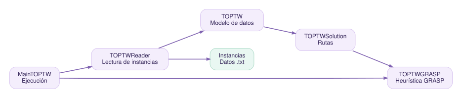

# Arquitectura del sistema

## Módulo principal `top`

| Clase | Responsabilidad principal |
|---|---|
| `MainTOPTW` | Selecciona instancias y lanza el algoritmo GRASP |
| `TOPTWReader` | Lee una instancia desde recursos del JAR o disco y crea el problema |
| `TOPTW` | Conserva puntos, ventanas temporales, puntuaciones y distancias |
| `TOPTWSolution` | Representa las rutas mediante sucesores y predecesores |
| `TOPTWGRASP` | Construye soluciones voraces aleatorizadas con RCL |
| `TOPTWEvaluator` | Marcador de evaluación; implementación sin completar |
| `TOPTWRoute` | Estructura auxiliar para rutas |

Las clases de `es.ull.esit.utilities` y `es.ull.esit.utils` ofrecen funciones de formato, matrices, recorridos y pares. Los diagramas UML detallados se obtienen ejecutando `doxygen Doxyfile`, con `HAVE_DOT = YES`.

## Flujo de ejecución

1. `MainTOPTW` elige una instancia.
2. `TOPTWReader` carga el fichero.
3. `TOPTW` construye la matriz de distancias.
4. `TOPTWSolution` prepara las rutas.
5. `TOPTWGRASP` construye rutas candidatas y comunica sus resultados.

## Datos de las instancias

El directorio de recursos contiene datos de prueba `c*`, `r*`, `rc*`, `pr*` y `c101Recortada.txt` y un documento `formatInstances.txt` con su especificación. Para pruebas rápidas se utiliza la instancia recortada.
