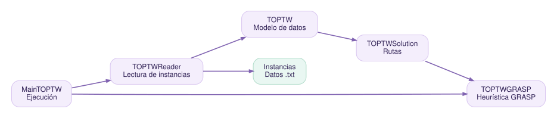

# RTVRPTW · ExpositoTOP

**Portal de documentación técnica · Práctica 3 · Curso 2026–2027**

> Universidad de La Laguna · Grado en Ingeniería Informática · Laboratorio de Desarrollo y Herramientas

Este portal reúne la documentación de un recomendador turístico con ventanas de tiempo (*Team Orienteering Problem with Time Windows*, TOPTW), adaptado desde el proyecto `ExpositoTOP.rar`.

!!! info "Qué contiene"
    Código Java reorganizado para Maven, pruebas con JUnit 5, integración de SonarQube y JaCoCo, comentarios Doxygen, grafos Graphviz y páginas Docs-as-Code con MkDocs y Material.

## Componentes

| Herramienta | Papel en el proyecto |
|---|---|
| Maven | Compilar, probar, empaquetar, instalar y desplegar un artefacto local |
| JUnit 5 + JaCoCo | Probar funcionalidades y generar cobertura medible |
| SonarQube | Evaluar mantenibilidad, fiabilidad y seguridad del código |
| Doxygen + Graphviz | Extraer documentación de las clases y producir diagramas |
| MkDocs + Material + MkDoxy | Publicar el portal unificado de documentación |

**Primer paso:** consulta el [manual de usuario](manual-usuario.md) o la guía `GUIA_PASO_A_PASO.md` incluida en el repositorio.

**Autor del informe:** Daniel Alejandro Álvarez Casablanca.

**Transparencia:** las métricas numéricas de SonarQube se completarán al ejecutar el servidor y conservar las evidencias reales. Ninguna métrica se ha inventado.
